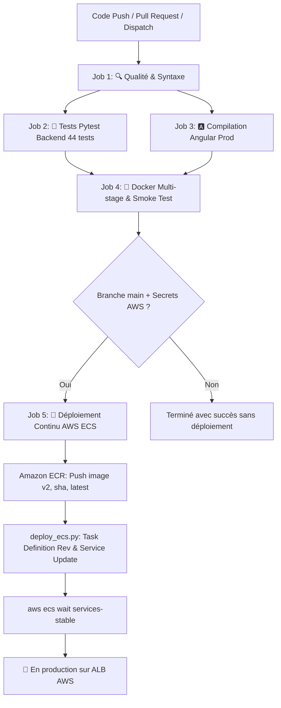

# 🚀 Pipeline CI/CD GitHub Actions — Règlement de Comptes

Ce document décrit l'architecture et le fonctionnement de la **pipeline complète de bout en bout** configurée pour le projet **Règlement de Comptes** (Datathon PolyFinances 2026).

---

## 🎯 Vue d'Ensemble & Architecture de la Pipeline

La pipeline GitHub Actions (`.github/workflows/ci-cd.yml`) automatise l'ensemble du cycle de vie du projet à chaque `push` ou `pull_request` sur les branches principales (`main`, `master`), ainsi que sur déclenchement manuel (`workflow_dispatch`).

---

## 🧩 Les 5 Étapes de Bout en Bout

### 1. 🔍 Qualité & Syntaxe du Code (`lint-and-quality`)
- **Compilation Python** : Validation de la syntaxe de tous les modules de `backend/` et du script de déploiement `deploy_ecs.py`.
- **Linting Flake8** : Détection des erreurs critiques (`E9`, `F63`, `F7`, `F82`) : variables non déclarées, syntaxe invalide, imports brisés.

### 2. 🧪 Tests Unitaires & Intégration Backend (`test-backend`)
- Environnement Python 3.12 avec mise en cache `pip` basée sur `requirements.txt`.
- Exécution de la suite complète des **44 tests unitaires** :
  - `test_analogie.py` : vulgarisation par analogies contextuelles et repli gracieux.
  - `test_analyse_avancee.py` : calculs de moments, VaR 95%, CVaR, ratios de Sharpe, Bêta.
  - `test_api.py` : routes FastAPI, filtrage du greffier, archiviste, mémoire de conversation.
  - `test_moteur.py` : intégrité des séries temporelles (1 304 séances quotidiennes en CAD).
  - `test_nouveautes.py` : intention NLP, scénarios alternatifs, arbitrage OUI/NON, PDF du greffier.
  - `test_simulateur.py` : modélisation patrimoniale des 3 scénarios (pire perte, moyen, meilleur gain).
- Génération et archivage automatique des rapports JUnit XML.

### 3. 🅰️ Compilation Frontend Angular (`build-frontend`)
- Environnement Node.js 22 avec mise en cache `npm` basée sur `package-lock.json`.
- Installation propre via `npm ci --no-audit --no-fund`.
- Build de production optimisé via `npm run build` (`ng build`).
- Vérification de l'intégrité du répertoire `dist/` et archivage de l'artefact (7 jours de rétention).

### 4. 🐳 Construction Docker & Smoke Test (`docker-smoke-test`)
- Construction multi-stage avec `Dockerfile.aws` :
  1. Étape 1 : Build Angular sous `node:22-alpine`.
  2. Étape 2 : Runtime léger sous `python:3.12-slim` avec utilisateur sécurisé non-root `app`.
- **Smoke Test automatisé** :
  - Démarrage du conteneur en arrière-plan sur le port 8501.
  - Boucle d'interrogation de santé (`GET /api/sante`).
  - Validation de l'intégrité des personas (`GET /api/profils`).
  - Validation de la distribution de la Single Page Application Angular (`GET /`).
  - Arrêt propre et nettoyage du conteneur.

### 5. 🚀 Déploiement Continu sur AWS ECS (`deploy-ecs`)
- Déclenché automatiquement sur `main` / `master` (ou via le bouton manuel **Run workflow**).
- Authentification AWS via `aws-actions/configure-aws-credentials@v4`.
- Authentification sur le registre privé Amazon ECR (`022499011766.dkr.ecr.us-east-1.amazonaws.com`).
- Tagging et push de l'image sous 3 étiquettes : `:v2`, `:${{ github.sha }}` et `:latest`.
- Enregistrement de la nouvelle Task Definition et mise à jour sans interruption du service ECS `reglementdecomptes-238e` sur le cluster `default`.
- Stabilisation surveillée via `aws ecs wait services-stable`.
- Publication d'un rapport visuel dans `$GITHUB_STEP_SUMMARY`.

---

## 🔑 Configuration des Secrets GitHub

Pour activer le déploiement automatique sur votre compte AWS, ajoutez les variables suivantes dans votre dépôt GitHub :
👉 **Settings > Secrets and variables > Actions > New repository secret**

| Secret GitHub | Description | Requis ? |
|---|---|---|
| `AWS_ACCESS_KEY_ID` | Clé d'accès AWS (Workshop Studio ou IAM) | **Oui** |
| `AWS_SECRET_ACCESS_KEY` | Clé secrète AWS | **Oui** |
| `AWS_SESSION_TOKEN` | Jeton de session temporaire (Workshop Studio) | Requis si compte temporaire |
| `AWS_REGION` | Région AWS (`us-east-1`) | Optionnel (défaut `us-east-1`) |

> **Note de sécurité** : Si les secrets ne sont pas configurés (ex: pull request d'un contributeur externe), la pipeline exécute et valide quand même 100 % des tests, des builds et des conteneurs, et ignore élégamment le déploiement sans provoquer d'erreur.

---

## 🕹️ Déclenchement Manuel (Workflow Dispatch)

Vous pouvez lancer un déploiement ou un test à la demande depuis l'interface GitHub :
1. Allez sur l'onglet **Actions**.
2. Cliquez sur **CI/CD Pipeline - Règlement de Comptes** dans la colonne de gauche.
3. Cliquez sur le bouton **Run workflow** à droite.
4. Sélectionnez la branche et activez/désactivez l'option de déploiement AWS.
5. Cliquez sur **Run workflow**.

---

## 🌐 Application en Production

Une fois le déploiement terminé par la pipeline, l'application est accessible en ligne sur l'adresse officielle de l'Application Load Balancer ECS :
👉 **[https://re-a7802df919724e0e835df4e1be537b1a.ecs.us-east-1.on.aws/](https://re-a7802df919724e0e835df4e1be537b1a.ecs.us-east-1.on.aws/)**
